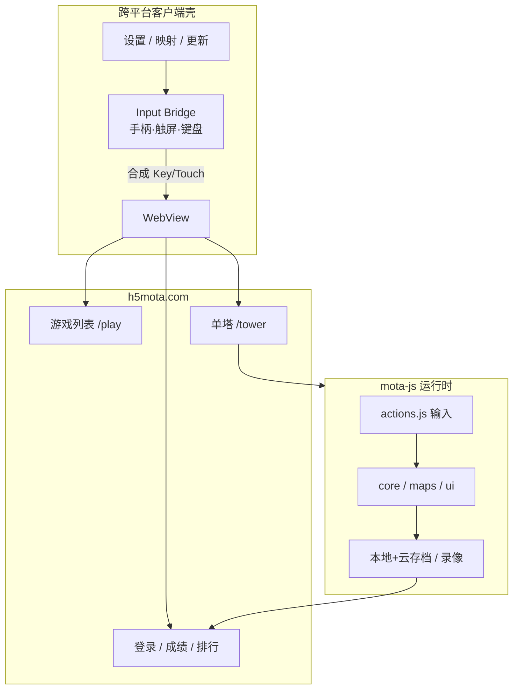

# 魔塔跨平台客户端 — 需求分析

> 状态：需求分析阶段（未进入编码）  
> 依赖站点：https://h5mota.com/play/#/ （HTML5 魔塔广场）  
> 项目目录：`D:\Project\Tower`（当前为空仓库，尚未初始化 Git）

---

## 1. 项目目标

基于 **HTML5 魔塔广场（h5mota.com）** 构建一款跨平台客户端，使用户能够：

1. 浏览并游玩广场上的 2000+ 魔塔作品；
2. 使用 **手柄** 与 **触屏** 获得完整、可玩的操控体验；
3. 在多端（至少桌面 + 移动）上获得一致的核心玩法体验；
4. 通过 **GitHub** 进行版本管理、协作与发布。

一句话定位：**“h5mota 广场的跨平台手柄/触屏客户端”**，而不是重写魔塔引擎，也不是本地造塔器。

---

## 2. 现状调研

### 2.1 平台侧（h5mota.com）

| 项 | 事实 |
|---|---|
| 产品 | HTML5 魔塔广场，专业魔塔游戏平台 |
| 内容 | 2000+ 塔，含多样世界观、创新机制、剧情 |
| 游玩 | 全部有 **在线版本**，无需下载 |
| 账号 | 注册/登录、评分、排行榜、论坛、QQ 群 |
| 造塔 | 可视化编辑器（含手机版） |
| 技术 | 自研引擎 **mota-js**，HTML5 Canvas |
| 迁移 | 站点提示“已经迁移完毕”（前端资源在 `static.mota.press`） |

站点主路径（调研所得）：

- `/` — 官网首页
- `/play/` — 游戏列表（SPA，需 JS）
- `/tower/?name=<id>` — 单塔游玩页
- `/user/login.html`、`/user/register.html` — 账号
- `/bbs/` — 论坛
- `/games/<id>/editor.html` — 造塔编辑器

### 2.2 引擎侧（mota-js，BSD-3-Clause）

仓库：https://github.com/ckcz123/mota-js  
文档：https://ckcz123.github.io/mota-js/  
版本：V2.10.x（2023.2 后维护节奏放缓，master 最近提交约 2024-01）

**运行时结构（与本 App 相关）：**

```
libs/          # 系统库：core / actions / control / maps / ui / loader ...
project/       # 每座塔的内容：地图、事件、素材、音频、脚本
index.html     # 游戏入口
main.js        # 动态加载
```

**输入模型（关键约束）：**

引擎的输入层是 **键盘 keyCode + 鼠标/触点坐标**，没有原生 Gamepad API。

| 输入 | 机制 |
|---|---|
| 键盘 | `onkeyDown` / `onkeyUp`，基于 `keyCode`；方向键 37–40 可持续按住 |
| 鼠标/触屏 | `ondown` / `onup`（`onclick` 已废弃并视为 `ondown`） |
| 左手模式 | `leftHandPrefer`：WASD↔方向、IJKL↔存读档 |
| 虚拟键盘 | 内置；手机端工具栏 1–7 快捷键 |
| 自动寻路 | 键盘可触发 |

**默认快捷键（`project/functions.js` → `actions.onKeyUp`）：**

| 键 | 行为 |
|---|---|
| ↑↓←→ / WASD | 移动 |
| ESC | 菜单 |
| X | 怪物手册 |
| G | 楼传器 |
| A / W | 读自动存档 / 撤销 |
| S / D | 存档 / 读档 |
| T / Q | 道具栏 / 装备栏 |
| Z | 转向 |
| V | 快捷商店 |
| Space | 轻按 |
| R | 录像 |
| PgUp/PgDn | 浏览地图 |
| B / H / M | 统计 / 帮助 / 存档笔记 |
| N / O / P | 重开 / 工程 / 主页 |
| 1–4 | 破/炸/飞/其他道具 |
| 5–7 | 手机向：回退 / 撤销 / 轻按 |
| F | 技能二倍斩 |
| F7/F8 | Debug |

**存档与成绩：**

- 本地存档（压缩，支持 1000 页）+ 离线 `_saves` 目录
- 服务器同步存档
- 录像（route）系统：可回放、可校验、计入排行榜
- 反作弊：控制台检测、生命上限校验、匿名成绩降权

**移动端已有能力（引擎内建，非本项目新增）：**

- 虚拟键盘、手机端工具栏、横竖屏状态栏、长按跳过对话
- 手机快捷键 5/6/7、快捷换装、商店长按连买
- 手机版编辑器 `editor-mobile.html`

### 2.3 官方客户端（已有，必须纳入决策）

| 仓库 | 平台 | 技术 | 状态 |
|---|---|---|---|
| [H5mota-Android](https://github.com/ckcz123/H5mota-Android) | Android | Kotlin | 活跃度低（41 commits，2024-08） |
| [H5mota-ios](https://github.com/ckcz123/H5mota-ios) | iOS | Objective-C + CocoaPods | 几乎空壳（1 commit） |
| [H5motaMaker](https://github.com/ckcz123/H5motaMaker) | Android 造塔 | Java | 停更 |

**含义：** 官方已有移动端壳，但 **不覆盖桌面、不覆盖统一手柄体验、iOS 未完成**。本项目与其是互补/并行关系，不是简单重复；但命名、商标、上架需避免与官方客户端混淆。

### 2.4 魔塔玩法对输入的要求

魔塔是 **格子走位 + 菜单确认** 的回合/半即时解谜 RPG，不是动作游戏：

1. **四向移动**是核心（有时斜向、变速、推箱子、滑冰）；
2. **大量二级 UI**：怪物手册、道具/装备、商店、楼传、地图浏览、存读档、设置；
3. **确认/取消** 贯穿对话与选项；
4. **长按/连点** 有语义（跳过对话、连买、回退）；
5. **录像一致性**：任何“多出来的输入路径”若改变 route，会破坏排行榜公平性。

→ 手柄方案必须映射到 **已有 keyCode 语义**，而不是绕过引擎另做一套逻辑。

---

## 3. 用户与使用场景

### 3.1 目标用户

| 角色 | 诉求 | 优先级 |
|---|---|---|
| 手柄玩家 | 沙发/掌机上玩魔塔，不想碰键鼠 | P0 |
| 手机/平板触屏玩家 | 随时开塔，触控舒适、误触少 | P0 |
| 桌面键鼠玩家 | 窗口/全屏、快捷键、多塔切换 | P1 |
| 观众/回放用户 | 看录像、分享成绩 | P2 |
| 造塔作者 | 编辑器（可跳转 Web，不在 v1 范围） | P3 |

### 3.2 典型场景

1. **掌机/手柄拆塔**：启动 App → 浏览列表 → 进入塔 → 十字键移动 → A 确认 → B 返回 → 菜单存档。
2. **手机通勤**：竖屏/横屏 → 虚拟方向或点击移动 → 触控打开手册/道具。
3. **电脑深度玩**：全屏 → 键盘快捷键 + 手柄可选 → 多存档管理 → 录像回放。
4. **跨设备续玩**：登录 h5mota 账号 → 云存档拉取（若平台 API 允许）。

---

## 4. 范围定义

### 4.1 In Scope（v1）

- 以 h5mota 在线内容为源的 **游戏浏览 / 进入 / 游玩**
- **手柄完整映射**（可配置）
- **触屏操作层**（含手势、虚拟控件可选）
- 键盘（桌面）
- 登录态（WebView 复用站点登录）与基础设置
- 存档：优先复用引擎本地/云端机制
- Windows / macOS / Linux 桌面 + Android / iOS 移动（见 §7 优先级）
- GitHub 仓库、CI、Issue/Project 管理

### 4.2 Out of Scope（v1 明确不做）

- 本地造塔 / 编辑器完整封装
- 自建游戏内容库或离线打包 2000+ 塔（版权与体积）
- 修改 mota-js 引擎核心逻辑（除非通过官方扩展点注入输入）
- 自建排行榜（复用站点）
- 成就/社交私有化

---

## 5. 功能需求（FR）

### 5.1 壳与导航

| ID | 需求 | 优先级 |
|---|---|---|
| FR-APP-01 | 启动进入 h5mota 游戏广场（默认 `/play/` 或配置首页） | P0 |
| FR-APP-02 | 支持前进/后退/刷新/在浏览器打开 | P0 |
| FR-APP-03 | 全屏/窗口模式；移动横竖屏自适应 | P0 |
| FR-APP-04 | 断网提示与重试 | P0 |
| FR-APP-05 | 用户代理/注入脚本可配置（用于输入桥与版本标识） | P0 |
| FR-APP-06 | 多标签/最近游玩列表（本地） | P1 |
| FR-APP-07 | 深链：`h5mota://tower/<name>` 直达某塔 | P1 |

### 5.2 游玩

| ID | 需求 | 优先级 |
|---|---|---|
| FR-PLAY-01 | 完整游玩在线塔（对话、战斗、商店、楼传、存读档） | P0 |
| FR-PLAY-02 | 复用引擎虚拟键盘/工具栏（触屏端） | P0 |
| FR-PLAY-03 | 键盘快捷键完整可用（桌面） | P0 |
| FR-PLAY-04 | 手柄可完成 100% 核心流程（含二级菜单） | P0 |
| FR-PLAY-05 | 录像播放可控制（播放/暂停/加速） | P1 |
| FR-PLAY-06 | 成绩上传与排行榜（站点原生） | P1 |
| FR-PLAY-07 | 云存档可见性与同步状态提示 | P1 |

### 5.3 输入 — 手柄（核心差异点）

| ID | 需求 | 优先级 |
|---|---|---|
| FR-PAD-01 | 标准映射（Xbox/DualSense/Switch Pro/通用 HID） | P0 |
| FR-PAD-02 | 左摇杆/十字键 → 方向（含摇杆死区） | P0 |
| FR-PAD-03 | A/× → 确认、轻按；B/○ → 取消/返回 | P0 |
| FR-PAD-04 | 快捷肩键映射：手册、道具、装备、存读档、楼传、菜单 | P0 |
| FR-PAD-05 | 映射可编辑、可恢复默认、可按游戏覆盖 | P0 |
| FR-PAD-06 | 热插拔检测与震动（若游戏/系统支持，可选） | P1 |
| FR-PAD-07 | 多手柄：指定主手柄 | P2 |
| FR-PAD-08 | 输入桥将 Gamepad 事件转换为 `KeyboardEvent`（keyCode 语义）注入 WebView | P0 |

**建议默认手柄映射（可改）：**

```
十字键/左摇杆   → ↑ ↓ ← →
A (Cross)      → Enter / Space（确认·轻按）
B (Circle)     → Esc（取消·菜单）或 Backspace
X (Square)     → T 道具栏
Y (Triangle)   → Q 装备栏
LB / L1        → X 怪物手册
RB / R1        → G 楼传器
LT / L2        → S 存档
RT / R2        → D 读档
Start          → Esc 菜单
Select/Back    → R 录像 / B 统计
左摇杆按下     → Z 转向
右摇杆按下     → Space 轻按
```

> 实现原则：**只翻译按键，不篡改 route**。所有输入最终都应走引擎已有的 key/touch 通道，保证录像与排行榜兼容。

### 5.4 输入 — 触屏

| ID | 需求 | 优先级 |
|---|---|---|
| FR-TCH-01 | 点击地图移动/交互（引擎原生） | P0 |
| FR-TCH-02 | 可选屏幕虚拟方向键/动作键（覆盖在 WebView 上） | P0 |
| FR-TCH-03 | 手势：滑动=移动方向；双指捏合=缩放视图（若引擎支持缩放） | P1 |
| FR-TCH-04 | 长按跳过对话、长按连买等引擎语义保持 | P0 |
| FR-TCH-05 | 安全区/刘海/手势条适配 | P0 |
| FR-TCH-06 | 虚拟控件可隐藏、半透明、位置可调 | P1 |
| FR-TCH-07 | 触控防误触（游戏区 vs 系统手势） | P0 |

### 5.5 账号与数据

| ID | 需求 | 优先级 |
|---|---|---|
| FR-ACC-01 | 复用站点 Cookie/LocalStorage 登录 | P0 |
| FR-ACC-02 | 本地设置持久化（映射、音量、全屏、控件布局） | P0 |
| FR-ACC-03 | 存档导入/导出（文件） | P1 |
| FR-ACC-04 | 隐私：不上传非必要数据 | P0 |

### 5.6 平台与发布

| ID | 需求 | 优先级 |
|---|---|---|
| FR-REL-01 | GitHub Releases 分发桌面构建 | P0 |
| FR-REL-02 | Android APK/AAB（侧载优先，商店可选） | P1 |
| FR-REL-03 | iOS（需 Apple 开发者账号；TestFlight） | P2 |
| FR-REL-04 | 自动更新检查（桌面） | P2 |

---

## 6. 非功能需求（NFR）

| ID | 类别 | 要求 |
|---|---|---|
| NFR-01 | 兼容 | 跟踪 h5mota 前端更新；输入注入层可热更新/容错 |
| NFR-02 | 性能 | 进塔加载与 60fps 走图不明显劣于浏览器；桌面 1080p 稳定 |
| NFR-03 | 延迟 | 手柄输入到画面响应 ≤ 1 帧（本地映射，无网络往返） |
| NFR-04 | 可靠 | WebView 崩溃可恢复；断网可提示并重试 |
| NFR-05 | 安全 | 不注入执行任意远程脚本的通道；CSP/外链策略收紧 |
| NFR-06 | 可访问 | 字体缩放、高对比、色盲友好（尽力） |
| NFR-07 | 本地化 | 简体中文优先；UI 预留 i18n |
| NFR-08 | 隐私 | 遵循站点隐私政策；本地设置可清除 |
| NFR-09 | 合规 | 见 §8 法律 |
| NFR-10 | 可维护 | 输入映射与壳层解耦；单测覆盖映射表 |

---

## 7. 技术方案分析

### 7.1 总体路线对比

| 路线 | 描述 | 优点 | 缺点 | 适配度 |
|---|---|---|---|---|
| **A. WebView 壳（推荐）** | Capacitor / Tauri+WKWebView·WebView2 / 原生壳包在线站 | 最快对齐站点；自动吃内容更新；手柄可注入 | 依赖站点可用性；输入桥需各端实现 | ★★★★★ |
| B. 离线引擎嵌入 | 把 mota-js + 本地塔打进包 | 可离线；可控 | 版权/体积；无法吃 2000+ 在线塔；维护 fork | ★★☆ |
| C. 原生重写客户端 | 原生 UI + 自研运行时 | 体验上限高 | 成本极高，重复造轮子 | ★☆ |
| D. PWA | 站点直接 PWA 化 | 零安装 | iOS 手柄/全屏弱；上架/桌面集成差 | ★★★（补充） |

**结论：v1 采用 A（WebView 壳 + 输入桥）**，PWA 可作为低成本旁路。

### 7.2 壳框架建议

| 平台 | 建议 | 理由 |
|---|---|---|
| 桌面 Win/mac/Linux | **Tauri 2** 或 **Electron** | Tauri 体积小；Electron 生态熟。二者均易接 Gamepad |
| Android | **Capacitor WebView** 或 Kotlin 官方壳增强 | 官方 H5mota-Android 可作参考，勿直接分叉其商标 |
| iOS | Capacitor → WKWebView | 官方 iOS 仓几乎空白，自建更可控 |
| 统一抽象 | 共享 **input-bridge** 逻辑（TS 编译到注入脚本） | 一份映射逻辑，多端复用 |

备选：单一 **Flutter + webview_flutter** 跨全端 — 手柄插件成熟度一般，需评估。

### 7.3 输入桥（关键技术）

```
[物理手柄] ──Gamepad API / 平台 HID──► [壳层输入服务]
                                            │ 映射表 (JSON)
                                            ▼
                              合成 KeyboardEvent / 触控事件
                                            │
                                            ▼
                              WebView 内 mota-js actions.js
                              (onkeyDown/onkeyUp/ondown/onup)
```

约束：

1. 映射输出必须是引擎认识的 `keyCode`（见 §2.2）；
2. 持续按住方向键需模拟 key repeat（引擎对 arrow 有 holdingKeys）；
3. 不要在录像路径之外“代打”；
4. 映射表版本化，支持游戏级 override。

### 7.4 架构示意



---

## 8. 法律、合规与品牌

| 议题 | 分析 | 建议 |
|---|---|---|
| mota-js 许可 | BSD-3-Clause | 可基于引擎开发；**不得**用原作者名号暗示官方背书 |
| 游戏内容 | 2000+ 塔版权归各作者 | **不要**批量下载/再分发；仅在线加载 |
| 商标/命名 | 存在官方 H5mota-Android/iOS | 避免 “官方/Official/H5mota” 命名；建议如 `TowerPlay` / `MotaDeck` 等 |
| 账号 | 登录走站点 | 明确“第三方客户端”，隐私政策说明 Cookie 存储 |
| 应用商店 | iOS/Android 审核 | 需内容分级、隐私清单；WebView 壳被拒风险要评估 |
| 反作弊/排行 | 录像与控制台检测 | 客户端不得帮助绕过；手柄映射必须可审计 |
| 联系官方 | 艾之葵 / QQ 群 539113091 | 若走发行，建议先沟通授权或致谢 |

---

## 9. GitHub 工程管理

### 9.1 仓库形态

单仓 monorepo（推荐）：

```
Tower/
├─ docs/                    # 需求、设计、决策记录 ADR
├─ app/                     # 壳应用（Tauri/Electron/Capacitor）
│  ├─ src/                  # 设置 UI、壳逻辑
│  ├─ src/input/            # Input Bridge（可单测）
│  └─ src/injected/         # 注入 WebView 的脚本
├─ packages/input-mapping/  # 映射表 schema + 校验 + 单测
├─ .github/
│  ├─ workflows/            # lint / test / build
│  ├─ ISSUE_TEMPLATE/
│  └─ PULL_REQUEST_TEMPLATE.md
├─ docs/01-需求分析.md      # 本文档
└─ README.md
```

### 9.2 协作流程

| 机制 | 约定 |
|---|---|
| 分支 | `main` 保护；`feat/*` `fix/*` |
| 提交 | Conventional Commits |
| PR | 模板 + CI 绿才能合 |
| Issues | Bug / Feature / Input-Mapping / Site-Breakage 模板 |
| Projects | GitHub Projects v2：Backlog → In Progress → Review → Done |
| Milestones | 见 §10 |
| 发布 | Tag + GitHub Releases（桌面）；移动侧载包 |

### 9.3 CI 必备

1. `input-mapping` 单元测试（映射完整性、冲突检测）；
2. 桌面构建产物；
3. 注入脚本语法检查；
4. （可选）Playwright 冒烟：打开 `https://h5mota.com/play/` 检查 DOM 可达。

---

## 10. 里程碑建议

| 阶段 | 内容 | 出口标准 |
|---|---|---|
| **M0 立项** | 本需求文档、仓库初始化、命名确认 | 评审通过 |
| **M1 桌面 WebView MVP** | 打开 play、进塔、键盘可玩 | Windows 上完整过一塔教学关 |
| **M2 输入桥** | 手柄默认映射 + 触屏虚拟控件 | 手柄全流程可玩；映射可配置 |
| **M3 移动端** | Android APK；iOS 内测 | 触屏+手柄（Android）验收 |
| **M4 打磨** | 设置 UI、深链、自动更新、错误上报 | 候选发布 |
| **M5 发行** | 文档、Releases、致谢与合规文案 | 公开可用 |

---

## 11. 风险与缓解

| 风险 | 影响 | 缓解 |
|---|---|---|
| h5mota 前端改版/迁移 | 壳白屏或注入失效 | 版本探测 + 降级提示；输入桥与页面结构解耦 |
| 站点 API/鉴权变更 | 登录/云存档失败 | 只依赖浏览器可见会话，不做私有 API 硬编码 |
| 录像/排行不兼容 | 玩家成绩争议 | 输入只走 key/touch；文档声明“辅助输入设备” |
| iOS 上架被拒 | 无法官方分发 | TestFlight/侧载；或 PWA 兜底 |
| 与官方客户端冲突 | 法律/社区 | 独立命名、致谢、不冒充官方 |
| 引擎维护放缓 | 长期兼容 | 锁定兼容层；跟踪 forks/issues |
| 手柄型号碎片 | 映射失灵 | 标准映射 + 用户自定义 + 预设库 |

---

## 12. 待决问题（需你拍板）

1. **产品定位**：第三方增强客户端，还是希望未来与官方合作/合并？  
2. **平台优先级**：建议 `Windows → Android → macOS/Linux → iOS`，是否同意？  
3. **壳框架**：Tauri（轻） vs Electron（稳） vs Flutter（一码三端）？  
4. **触屏虚拟控件**：必须独立于引擎，还是尽量暴露引擎自带工具栏即可？  
5. **离线**：v1 是否必须支持离线玩已玩过的塔？（影响缓存/版权设计）  
6. **命名**：对外名称与包名？  
7. **账号**：是否需要“App 内原生登录 UI”，还是纯 WebView 登录页？

---

## 13. 验收口径（v1 Done 定义）

1. 在桌面端通过手柄完成：开塔 → 对话 → 战斗 → 开门 → 存/读档 → 楼传 → 通关一结局；  
2. 在 Android 真机通过触屏完成同等流程；  
3. 手柄映射可在设置中修改并持久化；  
4. 断网/站点 5xx 有明确错误页；  
5. GitHub 上 Issues/CI/Releases 流程可运转；  
6. 文档写明：第三方客户端、致谢 mota-js、内容版权归属说明。

---

## 附录 A — 调研来源

- https://h5mota.com/ 、 https://h5mota.com/play/
- https://github.com/ckcz123/mota-js （BSD-3-Clause，README、`libs/actions.js`、`project/functions.js`）
- https://ckcz123.github.io/mota-js/
- https://github.com/ckcz123/H5mota-Android
- https://github.com/ckcz123/H5mota-ios

## 附录 B — 名词

| 词 | 含义 |
|---|---|
| 塔 | 一部魔塔作品（关卡/剧本） |
| 拆塔 | 通关某座塔 |
| 造塔 | 制作魔塔作品 |
| mota-js | HTML5 魔塔样板引擎 |
| route/录像 | 玩家操作序列，用于回放与排行校验 |
| Input Bridge | 将手柄/触屏翻译为引擎输入事件的层 |
