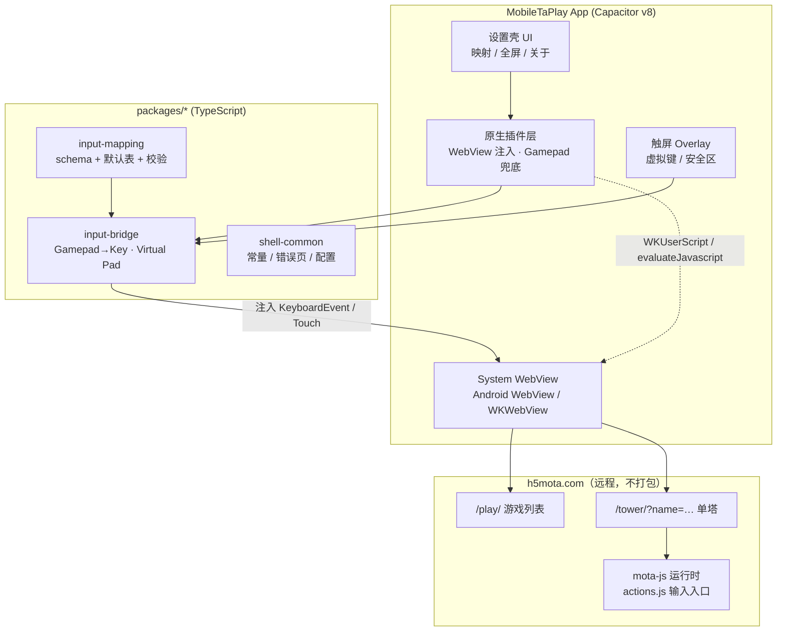

# MobileTaPlay — 架构设计（Capacitor）

> 状态：架构定稿 · 业务代码未实现  
> 壳：**Capacitor v8**（已锁定）  
> 平台优先级：Android → iOS → Win → macOS/Linux  
> 定位：纯第三方 · 无登录 · 仅加载 h5mota 在线游戏 · 手柄 + 触屏  
> 产品名：**MobileTaPlay**

---

## 1. 目标与边界

### 1.1 目标

在 Android/iOS（后续桌面）上，以 WebView 加载 `https://h5mota.com`，并提供：

1. 稳定的在线游玩（列表 → 进塔 → 存读档/录像等引擎原生能力）；
2. **Input Bridge**：手柄 → 引擎 keyCode；触屏 overlay 辅助；
3. 可配置手柄映射、基础设置；
4. GitHub 工程化（monorepo + CI + Issues/Projects）。

### 1.2 非目标（v1）

- 登录 UI / 账号体系（不做）
- 离线塔包 / 造塔器
- 自建排行、改引擎、绕过 route 录像

---

## 2. 总体架构



**原则：** 壳薄、输入逻辑厚；一切输入最终进入 mota-js 已有的 `onkeyDown/onkeyUp/ondown/onup`，**不篡改 route**。

---

## 3. 仓库结构（monorepo）

```
MobileTaPlay/                    # D:\Project\Tower
├─ docs/                         # 需求 / 调研 / 架构（已存在）
├─ packages/
│  ├─ input-mapping/             # 映射表 schema、默认配置、校验、单测
│  ├─ input-bridge/              # 注入用 TS：Gamepad/虚拟键 → keyCode
│  └─ shell-common/              # 共享常量、错误文案、设置 schema
├─ apps/
│  └─ mobile/                    # Capacitor 应用
│     ├─ src/                    # 设置 UI、注入入口、overlay
│     ├─ public/                 # 壳内静态资源（错误页、图标）
│     ├─ android/                # Capacitor Android 工程
│     ├─ ios/                    # Capacitor iOS 工程
│     ├─ capacitor.config.ts
│     └─ package.json
├─ .github/
│  ├─ workflows/ci.yml
│  ├─ ISSUE_TEMPLATE/
│  └─ PULL_REQUEST_TEMPLATE.md
├─ package.json                  # pnpm workspace root
├─ pnpm-workspace.yaml
├─ tsconfig.base.json
├─ README.md
└─ LICENSE
```

桌面端（Win/mac/Linux）**暂不建 app**，阶段 M3 再评估 Tauri 2 复用 `packages/*`。

---

## 4. Capacitor 集成设计

### 4.1 加载远程站点

v1 使用 Capacitor `server.url` 模式指向 h5mota（或可配置）：

```ts
// apps/mobile/capacitor.config.ts（示意）
const config: CapacitorConfig = {
  appId: 'com.mobiletaplay.app',
  appName: 'MobileTaPlay',
  server: {
    // 允许切到镜像/调试源；生产默认官网
    url: 'https://h5mota.com/',
    cleartext: false,
    // 可选：allowNavigation 限制域
  },
  android: { allowMixedContent: false },
  ios: { contentInset: 'automatic' },
};
export default config;
```

| 要点 | 说明 |
|---|---|
| 远程 URL | 首页可配置为 `/` 或 `/play/` |
| 导航限制 | 只允许 `h5mota.com`、`static.mota.press`、`*.mota.press` 等必要域 |
| UA | 追加 `MobileTaPlay/<version>` 便于站点识别与自省 |
| 回退 | 加载失败显示壳内错误页（`public/error.html`），提供重试 |

### 4.2 脚本注入（Input Bridge 注入点）

远程页 **不能** 当本地 bundle 塞进去，必须 **原生注入**：

| 平台 | 注入 API | 时机 |
|---|---|---|
| Android | `WebView.evaluateJavascript` / `WebViewClient.onPageFinished` + 必要时 `addJavascriptInterface` | 每次文档就绪后 |
| iOS | `WKUserScript`（atDocumentEnd）+ `evaluateJavaScript` | 文档结束 / SPA 路由变化 |

注入内容 = 编译后的 `input-bridge` IIFE（单文件、无外部依赖）。

**注入契约（伪接口）：**

```ts
// 注入后挂在 window.__MTP__
interface MobileTaPlayBridge {
  version: string;
  setMapping(mapping: Mapping): void;
  enableGamepad(on: boolean): void;
  setVirtualPad(on: boolean): void;
  // 壳 → 页：原生手柄兜底
  nativeGamepadEvent(e: { type: 'down'|'up'; keyCode: number } | { type: 'axis'; dx: number; dy: number }): void;
}
```

### 4.3 原生插件职责

| 插件 | 职责 | 优先级 |
|---|---|---|
| `MtpShell` | UA、版本、设置读写、打开错误页 | P0 |
| `MtpInject` | 注入/重注入 Input Bridge、监听 URL 变化 | P0 |
| `MtpGamepad` | （可选）Android KeyEvent / iOS GameController → 页内合成键 | P1，Web Gamepad 不够时启用 |
| `MtpOverlay` | 虚拟键布局、安全区、触摸透传 | P0–P1 |

---

## 5. Input Bridge 设计

### 5.1 数据流

```
物理手柄
  ├─ WebView Gamepad API（首选）
  └─ MtpGamepad 原生兜底 ──┐
                           ▼
虚拟触屏键 ──────────► input-bridge
                           │  mapping.json
                           ▼
              KeyboardEvent(keyCode) / Touch
                           ▼
              mota-js actions.js
```

### 5.2 映射表（`input-mapping`）

```jsonc
{
  "version": 1,
  "deadzone": 0.35,
  "bindings": {
    "dpad_up":    { "key": "ArrowUp" },
    "dpad_down":  { "key": "ArrowDown" },
    "dpad_left":  { "key": "ArrowLeft" },
    "dpad_right": { "key": "ArrowRight" },
    "button_a":   { "key": "Enter" },      // 确认/轻按语义由引擎 keyCode 决定
    "button_b":   { "key": "Escape" },
    "button_x":   { "key": "t" },          // 道具栏
    "button_y":   { "key": "q" },          // 装备栏
    "lb":         { "key": "x" },          // 怪物手册
    "rb":         { "key": "g" },          // 楼传
    "lt":         { "key": "s" },          // 存档
    "rt":         { "key": "d" },          // 读档
    "start":      { "key": "Escape" },
    "select":     { "key": "b" }
  }
}
```

实现时对齐 mota-js 真实 `keyCode`（见 `docs/01` 附录快捷键表）；**默认表在 M2 用真机校准**。

### 5.3 硬约束

1. 只产生引擎认识的键码/触点；
2. 方向键需模拟按住（`holdingKeys` 语义）；
3. 不在 route 外“代打”；
4. 映射可持久化、可恢复默认。

---

## 6. 触屏方案

| 层 | 内容 | 归属 |
|---|---|---|
| L0 | 引擎自带虚拟键盘/工具栏/点击移动 | 远程页面，直接用 |
| L1 | 安全区、刘海、手势条、沉浸式 | Capacitor / 原生 |
| L2 | 可选虚拟摇杆 / A·B 覆盖层 | `input-bridge` + Overlay |
| L3 | 手势（长按跳过等） | 尽量走引擎既有语义 |

v1 默认：**L0 + L1 必做；L2 可关可开（设置项）**。

---

## 7. 设置与持久化

| 配置 | 存储 | 同步 |
|---|---|---|
| 手柄映射 | Capacitor Preferences / 薄插件 | 本机 |
| 虚拟键开关/布局 | 同上 | 本机 |
| 入口 URL（测试） | 同上 | 本机 |
| 游戏内设置 | 站点 LocalStorage / 引擎 | 随 WebView |

无账号 → **无云端配置同步**（v1）。

---

## 8. 错误与韧性

| 场景 | 行为 |
|---|---|
| 无网络 / DNS 失败 | 壳错误页 + 重试 |
| 站点 5xx | 显示状态 + 重试 |
| 注入失败 | 日志 + 降级纯触屏；设置页提示 |
| WebView 崩溃 | 系统恢复；必要时冷启动到首页 |
| 站点改版白屏 | 版本探测（DOM 特征）+ 提示用户 |

---

## 9. 安全

- 域白名单，禁任意导航；
- 关闭 mixed content；
- 注入脚本 **自包含**，不 `eval` 远程代码；
- 不收集账号密码；日志不含 Cookie；
- 第三方客户端声明与 mota-js BSD-3 致谢（README/关于页）。

---

## 10. 构建与 CI

| 项 | 方案 |
|---|---|
| 包管理 | pnpm workspace |
| 语言 | TypeScript（packages + apps/mobile/src） |
| 测试 | `input-mapping` / `input-bridge` 单测（vitest） |
| CI | GitHub Actions：install → lint → test →（可选）Android debug 构建 |
| 发布 | M1 侧载 APK；后续 Play / TestFlight |

`ci.yml` 骨架：

```yaml
# .github/workflows/ci.yml
name: CI
on: [push, pull_request]
jobs:
  test:
    runs-on: ubuntu-latest
    steps:
      - uses: actions/checkout@v4
      - uses: pnpm/action-setup@v4
        with: { version: 9 }
      - uses: actions/setup-node@v4
        with: { node-version: 22, cache: pnpm }
      - run: pnpm install --frozen-lockfile
      - run: pnpm -r lint
      - run: pnpm -r test
```

---

## 11. 里程碑（对齐优先级）

| 阶段 | 交付 | 验收 |
|---|---|---|
| **M0** | 本架构 + 仓库骨架 + CI 绿 | clone 可 install/test |
| **M1** | Android：加载 `/play/` → 进塔触屏可玩；注入桥空跑 | 真机过教学塔 |
| **M2** | 手柄映射 UI；Web/原生手柄；虚拟键 | 手柄全流程或明确降级 |
| **M3** | iOS 包；安全区完善 | TestFlight / 侧载可玩 |
| **M4** | 桌面（Tauri 2 复用 packages） | Win 键盘+手柄 |
| **M5** | 打磨、文档、Releases | 公开可用 |

---

## 12. 模块接口草图（实现时展开）

```ts
// packages/input-mapping/src/types.ts
export interface Binding { key: string; /* 后续：mod? tap? hold? */ }
export interface Mapping {
  version: number;
  deadzone: number;
  bindings: Record<string, Binding>;
}

// packages/input-bridge/src/index.ts
export function installBridge(opts: {
  mapping: Mapping;
  onSyntheticKey(keyCode: number, type: 'down' | 'up'): void;
}): () => void; // teardown
```

---

## 13. 风险（架构层）

| 风险 | 缓解 |
|---|---|
| SPA 路由导致注入丢失 | 监听导航 / Mutation / 定时重注入 |
| `server.url` 与插件生命周期差异 | M1 spike 验证；备选本地壳页 + 跳转 |
| Gamepad 在 WebView 不稳 | `MtpGamepad` 原生兜底 |
| 站点 CSP | 实测；必要时用户脚本策略 |
| Capacitor 大版本升级 | 锁 v8；升级单独立项 |

---

## 14. 与既有文档关系

| 文档 | 关系 |
|---|---|
| `01-需求分析.md` | 范围与 FR/NFR 来源 |
| `02-壳框架调研.md` | 选型依据（已锁 Capacitor） |
| `03-Capacitor-Tauri成熟度.md` | 成熟度依据 |
| **本文** | 实现蓝图 |

---

## 15. 下一步（实现顺序）

1. 落地 monorepo 空壳与 CI（本阶段）；
2. Android spike：`server.url` + 注入 Hello → 驱动勇士移动；
3. 实现 `input-mapping` / `input-bridge` 核心；
4. 设置 UI + 映射持久化；
5. iOS 与手柄增强。
