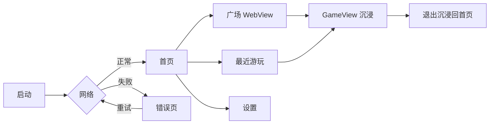

# MobileTaPlay — UI 壳层包装需求分析

> 状态：需求分析（**不实现**）  
> 前置：Capacitor v8 壳已能远程加载 h5mota（M1 APK）  
> 问题：当前是「整页 WebView 指到官网」，用户看到的是**原生网页**，缺少 App 壳感  
> 目标：用 **UI 框架包装一层壳**，WebView 变成壳内「游戏视图」，而不是裸浏览器

---

## 1. 问题定义

### 1.1 现状

```
[ 全屏 WebView ──────────────────────────── ]
  https://h5mota.com/     ← 站点自己的导航/页头/广告位
  /play/ 列表
  /tower/?name=… 游戏
```

**用户体感问题：**

| 问题 | 表现 |
|---|---|
| 像浏览器书签 | 打开就是网页，无 App 启动感 |
| 导航不受控 | 站点菜单、外链、论坛会把人带离「游玩」 |
| 无壳层操作 | 映射设置、手柄状态、重载、全屏需另做 |
| 视觉割裂 | 网站 UI 与 MobileTaPlay 品牌无关 |
| 真机沉浸感弱 | 状态栏/手势区/横竖屏都跟网站走 |

### 1.2 目标一句话

**「App 壳负责导航与输入体验，WebView 只负责玩魔塔。」**

---

## 2. 范围

### 2.1 In Scope（UI 壳）

1. 壳层页面：启动 / 首页 / 游戏入口 / 设置 / 错误
2. WebView **嵌入式游戏视图**（非整站浏览器）
3. 加载态、进度、失败重试
4. 手柄映射与虚拟键设置 UI
5. 沉浸式游玩模式（隐藏壳导航、全屏）
6. 基础信息：版本、致谢、第三方声明

### 2.2 Out of Scope（本需求）

- 重做魔塔玩法 UI / 状态栏（在引擎页面内）
- 登录、云同步、社区
- 造塔器
- 完整游戏库爬取/离线包

### 2.3 与既有架构关系

```
┌──────────────────────────────────────────┐
│  UI Shell（新增，本地资源）               │
│  首页 · 设置 · 启动 · 错误               │
│  ┌────────────────────────────────────┐  │
│  │  GameView (WebView)                │  │
│  │  只承载 h5mota 塔/列表相关路由      │  │
│  │  + Input Bridge 注入               │  │
│  └────────────────────────────────────┘  │
│  Virtual Pad / 手柄指示 · 全屏切换       │
└──────────────────────────────────────────┘
```

**关键变化：** 不再 `server.url = https://h5mota.com` 整站接管，改为 **本地壳 + 受限 WebView**。

---

## 3. 用户与场景

| 角色 | 场景 | 壳层要提供的 |
|---|---|---|
| 玩家 | 点开 App → 选塔 → 玩 | 首页、最近玩、一键进塔 |
| 手柄党 | 沙发上玩 | 全屏、映射设置、手柄状态 |
| 手机党 | 通勤触屏 | 虚拟键开关、安全区 |
| 排障 | 打不开/改版 | 错误页、重试、清缓存、诊断信息 |

---

## 4. 信息架构与关键流程

### 4.1 页面清单

| 页面 | 职责 | 优先级 |
|---|---|---|
| **Splash / 启动** | 品牌、版本、检查网络 | P0 |
| **首页 Home** | 快速入口：最近游玩、继续、广场 | P0 |
| **广场 Library** | 内嵌 WebView 打开 `/play/`（或精选列表） | P0 |
| **游玩 GameView** | 全屏/沉浸式 WebView + 工具条（可隐藏） | P0 |
| **设置 Settings** | 手柄映射、虚拟键、全屏、清除缓存 | P0 |
| **关于 About** | MIT、mota-js 致谢、第三方声明 | P1 |
| **错误 Error** | 断网/5xx/白屏诊断 | P0 |
| **映射编辑 Pad Map** | 手柄按键可视化配置 | P1 |

### 4.2 主流程



### 4.3 游玩内工具条（可自动隐藏）

| 控件 | 行为 |
|---|---|
| ← 返回 | 离开塔 / 回首页 |
| ⛶ 全屏 | 沉浸式切换 |
| 🎮 手柄 | 状态指示 / 映射 |
| ↻ 重载 | 重新注入并刷新 WebView |
| ⋯ | 设置、关于 |

---

## 5. 功能需求（FR）

### 5.1 壳框架与导航

| ID | 需求 | 优先级 |
|---|---|---|
| FR-UI-01 | 本地壳 UI，不把站点当应用根界面 | P0 |
| FR-UI-02 | WebView 仅加载白名单域名（h5mota / mota.press） | P0 |
| FR-UI-03 | 拦截外链（论坛、QQ、第三方）→ 外部浏览器或确认框 | P0 |
| FR-UI-04 | 壳内返回栈：GameView → Library/Home | P0 |
| FR-UI-05 | 启动可配置「直接进最近一座塔」 | P1 |
| FR-UI-06 | 深链 `mobiletaplay://tower/<name>` → GameView | P2 |

### 5.2 GameView（游戏视图）

| ID | 需求 | 优先级 |
|---|---|---|
| FR-GV-01 | 嵌入式 WebView 加载 `/tower/?name=…` | P0 |
| FR-GV-02 | 进入游玩默认沉浸式（隐藏系统栏/壳导航） | P0 |
| FR-GV-03 | 下滑/边缘手势可呼出工具条（或物理菜单键） | P0 |
| FR-GV-04 | 保持 Input Bridge 注入（含 SPA 重注入） | P0 |
| FR-GV-05 | 横竖屏跟随设置或跟随引擎 | P1 |
| FR-GV-06 | 防误触：游玩区不与系统手势冲突 | P0 |

### 5.3 首页 / 广场

| ID | 需求 | 优先级 |
|---|---|---|
| FR-HM-01 | 「继续玩」展示最近 5 座塔（本地） | P0 |
| FR-HM-02 | 「逛广场」进入列表 WebView | P0 |
| FR-HM-03 | 收藏塔（本地，按 name） | P1 |
| FR-HM-04 | 搜索：跳转站点搜索或本地过滤历史 | P2 |

### 5.4 设置

| ID | 需求 | 优先级 |
|---|---|---|
| FR-ST-01 | 虚拟键开关、透明度、左右手 | P0 |
| FR-ST-02 | 手柄映射查看/改/恢复默认 | P0 |
| FR-ST-03 | 沉浸式、状态栏、横竖屏 | P0 |
| FR-ST-04 | 清除 WebView 缓存 / Cookie | P0 |
| FR-ST-05 | 诊断信息（版本、UA、注入状态） | P1 |

### 5.5 加载与错误

| ID | 需求 | 优先级 |
|---|---|---|
| FR-ER-01 | 首屏 Loading（品牌 + 进度/文案） | P0 |
| FR-ER-02 | 失败：重试 / 打开诊断 / 反馈提示 | P0 |
| FR-ER-03 | 站点改版白屏检测（DOM 特征超时） | P1 |

---

## 6. 非功能需求（NFR）

| ID | 要求 |
|---|---|
| NFR-UI-01 | 壳 UI 启动 < 1s（不含站点加载） |
| NFR-UI-02 | GameView 切入 < 300ms 有反馈（骨架/进度） |
| NFR-UI-03 | 壳与站点视觉分离：品牌色、非站点 CSS |
| NFR-UI-04 | 可访问：动态字号、对比度、触控 ≥ 44dp |
| NFR-UI-05 | 中文优先，预留 i18n |
| NFR-UI-06 | 不注入广告/追踪；设置可清数据 |
| NFR-UI-07 | 引擎玩法 UI 仍归站点，壳不重绘血条等 |

---

## 7. UI 技术方案对比（选型输入，不在本步定案）

| 方案 | 壳 UI 形态 | 与 Capacitor | 优点 | 缺点 | 适配度 |
|---|---|---|---|---|---|
| **A. Ionic + Capacitor** | 预制移动导航/列表/设置 | 官方搭档 | 快、移动味正、文档多 | 视觉偏「Ionic 默认」 | ★★★★★ |
| **B. 自研轻壳（Vite + TS + CSS）** | 自绘页面 | 同包 | 品牌自由、包体小 | 要自己做导航/手势 | ★★★★ |
| **C. React/Vue + Capacitor** | SPA 壳 | 通用 | 生态大 | 栈更重 | ★★★★ |
| **D. 原生 Android Compose 包 WebView** | 系统级 UI | Capacitor 弱化 | 质感最好 | iOS 要再写；与现栈分裂 | ★★★ |
| **E. 纯站点改造（本站皮肤）** | 改 h5mota CSS | 无 | — | 第三方不能改站 | ☆ 不可行 |

**需求侧结论（供后续决策）：**

- 若要 **快速出可玩 App 壳** → A 或 B 足够  
- 若强调 **品牌独特、轻量** → B  
- 若团队已有 React/Vue → C  
- D 仅在追求「系统级导航栏」且接受双端原生成本时考虑  

> MobileTaPlay 现状（远程内容 + 注入桥）**不依赖** 某个 UI 框架；壳框架只影响 `apps/mobile` 本地页面。

---

## 8. 布局与交互原则

1. **首页「少而快」**：继续 / 广场 / 设置 三个入口足够  
2. **游玩「壳退位」**：进塔后隐藏壳 chrome，留给魔塔  
3. **工具条边缘化**：默认隐藏，手势/键唤出，避免遮挡 32px 图块  
4. **设置与玩法分离**：改映射不在塔内改，避免误触  
5. **品牌**：启动与首页用 MobileTaPlay 视觉；GameView 内尊重站点画风  

### 建议视觉方向（分析用，非定稿）

| 要素 | 建议 |
|---|---|
| 锚点 | 复古掌机/现代游戏库（Steam Deck / 街机精选） |
| 背景 | 深色 `#0F1419` |
| 主强调 | 魔塔金币黄/青金石蓝二选一作 Accent |
| 字体 | 系统黑体 + 等宽数字（步数/楼层） |
| 密度 | 首页低密度大点击区；设置列表密度中等 |

---

## 9. 与 Input Bridge 的边界

| 归属 | 内容 |
|---|---|
| **壳 UI** | 映射设置表单、虚拟键开关、手柄指示灯 |
| **Input Bridge** | 仍注入到 GameView 文档，合成 keyCode |
| **禁止** | 壳层「代玩」或写入 route |

虚拟键 overlay 可画在 GameView 之上，事件仍进 `emitControl`。

---

## 10. 技术影响（对现仓库）

| 模块 | 影响 |
|---|---|
| `apps/mobile` | 从 `server.url` 整站 → 本地 Vite 壳 + WebView 组件 |
| `capacitor.config` | `server.url` 去掉或仅调试；导航白名单加强 |
| `MtpInject` | 仅对 GameView WebView 生效 |
| 新增 | `apps/mobile/src/pages/*`、路由、设置存储 |
| `packages/shell-common` | 设置 schema 扩展（UI 偏好） |
| 构建 | 仍 Vite；可选 Ionic React/Vue 依赖 |

**工作量粗估（仅 UI 壳，不含玩法）：**

| 方案 | 人日（约） |
|---|---|
| A Ionic | 3–5 |
| B 轻壳 | 4–7 |
| C React/Vue | 4–7 |
| D 原生 Compose | 8–12（+ iOS 再一倍） |

---

## 11. 验收口径（UI 壳 v1）

1. 打开 App **不见**站点页头/外链导航，只见 MobileTaPlay 首页；  
2. 从首页 2 步内进入某塔并全屏游玩；  
3. 游玩中手势/键可呼出工具条，能回首页；  
4. 设置可改虚拟键与映射并生效（重启仍在）；  
5. 点击站点内论坛/外链不会在壳内乱跳；  
6. 断网有错误页与重试；  
7. Input Bridge 在 GameView 内仍工作（手柄可走图）。

---

## 12. 风险

| 风险 | 缓解 |
|---|---|
| 白名单过严导致站点资源失败 | 放行 `*.mota.press`、必要 CDN |
| 壳与 WebView 手势冲突 | 浸润式策略、边缘手势只在工具条区 |
| 本地壳 + 远程页路由复杂 | GameView 固定 `tower` URL 形态 |
| Ionic/React 选型摇摆耗时 | 先锁 B 轻壳或 A Ionic，P0 页面 ≤ 4 个 |
| 过度设计首页 | P0 只做三入口 |

---

## 13. 待决问题

1. **UI 框架**：Ionic / 自研轻壳 / React / Vue / Compose？  
2. **首页内容**：只要「最近 + 广场」，还是要有精选/搜索？  
3. **游玩导航**：工具条默认隐 or 常驻半透明？  
4. **虚拟键**：壳层绘制 or 仅用引擎自带工具栏？  
5. **品牌色/风格**：是否有既有 VI？

---

## 14. 建议的下一决策顺序

1. 锁 UI 框架（建议 1–2 天内：Ionic **或** 自研轻壳）  
2. 锁首页/游玩导航草图  
3. 再进入实现（替换 `server.url` 策略）  

---

## 附录 · 现状 vs 目标

| | 现状（M1 APK） | UI 壳包装后 |
|---|---|---|
| 根界面 | h5mota 网页 | MobileTaPlay 首页 |
| 导航 | 站点菜单 | 壳返回栈 |
| 手柄设置 | 无 UI | 设置页 |
| 外链 | 站点内跳转 | 拦截/外开 |
| 沉浸 | 跟网页 | 壳控制 |
| Input Bridge | 有 | 保留 |
