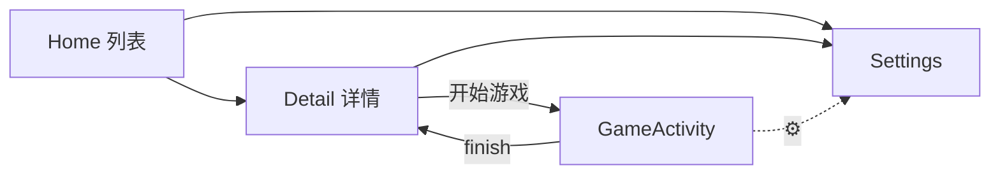

# MobileTaPlay — 纯 Android 原生 UI 架构

> 状态：设计定稿待实现  
> 方向：**Kotlin + Jetpack Compose**（或 XML，推荐 Compose）  
> 游戏仍是远程 WebView（h5mota / mota-js），壳 UI 全部原生  
> 产品名：MobileTaPlay

---

## 1. 目标形态

```
┌─────────────────────────────────────┐
│  Compose Navigation                 │
│  ├─ Home（塔列表）                   │
│  ├─ Detail（详情 + 开始游戏）         │
│  ├─ Settings（统一设置）              │
│  └─ Game（Activity/全屏容器）         │
│       ├─ WebView (h5mota games/)    │
│       ├─ 原生顶栏（可隐藏）            │
│       └─ 原生虚拟键 / 手柄            │
└─────────────────────────────────────┘
```

| 层 | 技术 |
|---|---|
| UI | Jetpack Compose + Material 3 |
| 导航 | Navigation Compose |
| 网络 | Retrofit / OkHttp（塔列表 API） |
| 图片 | Coil |
| 存档/设置 | DataStore / SharedPreferences |
| 游戏 | WebView + JavascriptInterface（输入桥） |
| 手柄 | `onKeyDown` / Gamepad `InputDevice` |

---

## 2. 页面结构

### 2.1 Home — 塔列表（主屏）

```
Scaffold
├─ TopAppBar: 「MobileTaPlay」 + 搜索 + ⚙设置 + ↻横竖屏
├─ SearchBar（标题/作者/简介）
├─ FilterRow（排序 chips + 分区 chips + 标签输入）
└─ LazyVerticalGrid(2)  // 横屏 3–4 列
    └─ TowerCard
         ├─ Coil 图 (16:10)
         ├─ 标题 / 作者
         └─ 评分 · 在玩 · 层数 · Tags
```

**数据：** `GET /backend/towers/list.php`（已有参数：page, sortmode, sections, tags, searchMode, searchStr, colors=[]）

### 2.2 Detail — 关卡详情

```
Scaffold
├─ TopAppBar: ← 返回 · 标题 · ↻ · ⚙
└─ 若横屏: Row | 竖屏: Column
    ├─ 左/上: HorizontalPager(previews)  // 单一图库
    └─ 右/下:
        ├─ 四格数据 (评分/在玩/通关/层数)
        ├─ Tabs: 简介 | 数据
        └─ 底部 FAB/Button「开始游戏」
```

### 2.3 Settings — 统一设置（全屏 Dialog 或独立页）

```
Scaffold
├─ TopAppBar ←
├─ 触控: 虚拟键开关 / 手柄时隐藏虚拟键
├─ 手柄: 启用 / 映射预览
└─ 恢复默认映射
```

存储键（与现网一致）：`mtp.virtualPad` `mtp.gamepad` `mtp.hidePadOnGamepad` `mtp.mapping`

### 2.4 Game — 游玩容器（独立 Activity，推荐）

```
GameActivity
├─ DecorFitsSystemWindows(false) 沉浸式
├─ Compose overlay
│   ├─ 顶栏（半透明 / ⛶全屏切换 / ⚙ / ←）
│   └─ 虚拟 D-Pad + A/B/T/Q（可按设置隐藏）
└─ WebView
    └─ https://h5mota.com/games/<link>/
         + MtpInject（手柄→keyCode，与现逻辑相同）
```

**返回栈：**

| 状态 | 系统返回 / ← |
|---|---|
| 全屏且顶栏隐藏 | 退出全屏 |
| 否则有 WebView 历史 | `webView.goBack()` |
| 否则 | `finish()` → Detail |

---

## 3. 导航图



---

## 4. 手柄映射（沿用当前表）

| 手柄 | 功能 | 注入 keyCode |
|---|---|---|
| ↑↓←→ / 左摇杆 | 移动 | 37–40 |
| A | 确认 | Space(32) |
| B | 读自动存档 | A(65) |
| L1 / R1 | 存 / 读档 | S(83) / D(68) |
| X | 楼传 | G(71) |
| Y | 怪物手册 | X(88) |
| L2 / R2 | 道具 / 装备 | T(84) / Q(81) |
| Start | 菜单 | Esc(27) |
| Select | 全屏切换 | 壳层处理（非 keyCode） |

实现：GameActivity 拦截 `dispatchKeyEvent` → 合成 `WebView.evaluateJavascript` 注入 keydown/keyup。

---

## 5. 模块/包结构

```
app/src/main/java/com/mobiletaplay/app/
├─ MainActivity.kt          // Compose + NavHost
├─ GameActivity.kt          // WebView + overlay + 手柄
├─ ui/
│  ├─ home/HomeScreen.kt
│  ├─ detail/DetailScreen.kt
│  ├─ settings/SettingsScreen.kt
│  └─ theme/Theme.kt        // #0F1419 深色
├─ data/
│  ├─ TowerApi.kt           // list.php
│  ├─ TowerModels.kt
│  └─ SettingsRepo.kt
├─ input/
│  ├─ GamepadMapper.kt      // 映射表
│  └─ InjectJs.kt           // 与现 MtpInject 对齐
└─ web/
   ├─ GameWebView.kt
   └─ MtpBridge.kt          // JS interface
```

---

## 6. 与现 Capacitor 壳对照

| | Capacitor/Vue | 纯 Android Native |
|---|---|---|
| 列表/详情 UI | WebView 内 Vue | Compose |
| 设置 | Vue + 弹窗 | Compose |
| 游戏 | 同 WebView 导航 | 独立 GameActivity + WebView |
| 手柄 | 注入 + Gamepad API | 原生 KeyEvent + 注入 |
| iOS/桌面 | 理论可复用 | **需另做** |
| 包体 | ~4.2MB | 略大或相近 |
| 体验 | 壳感一般 | **系统级流畅** |

---

## 7. 实现顺序（若开工）

1. 工程：Compose + Nav + DataStore + Coil  
2. Home 列表接 API  
3. Detail + previews pager  
4. GameActivity WebView + 返回/全屏策略  
5. 手柄 KeyEvent → 注入  
6. 虚拟键 overlay  
7. 设置统一  
8. 打包 APK、adb 安装  

---

## 8. 风险

| 风险 | 缓解 |
|---|---|
| 放弃 iOS/桌面 | 产品只承诺 Android 时可接受 |
| 与现仓库双轨 | 可 `app/` 旁路或 `android-native/` 新模块 |
| 站点改版 | 仍只依赖 list API + /games/ 运行时 |
| WebView 手柄 | 原生转发，比 Gamepad API 更稳 |

---

## 9. 待确认

1. **Compose** 还是 XML？（推荐 Compose）  
2. 是否 **放弃 iOS** 后续目标？  
3. Game 用 **独立 Activity** 还是单 Activity Fragment？（推荐独立 Activity）  
4. 从现工程迁移到 `app/` 原生，还是新建目录？
